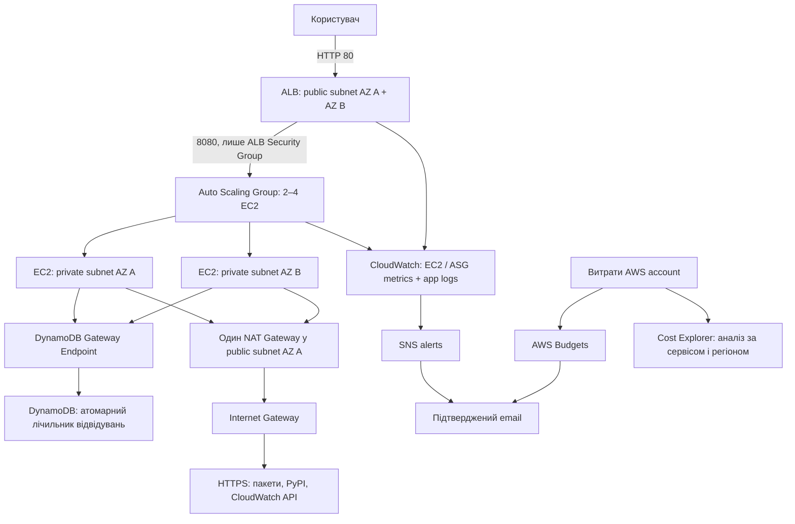

# Фінальний проєкт — AWS через Terraform

Статус: підготовлено файли. Terraform, AWS CLI, застосунок та навантажувальні тести під час підготовки **не запускалися**. Ресурси не розгорталися, URL і результати тестування ще відсутні. Це окреме навчальне завдання, не інфраструктура торгової системи.

## Архітектура та вибір технологій

Обрано EC2 — один із дозволених варіантів. Amazon Linux 2023, Python 3, невеликий JSON-вебзастосунок і systemd дають самодостатнє розгортання без контейнерного registry. ECR не потрібен. ALB розподіляє HTTP-запити між EC2 у двох AZ. ASG має min/desired/max = 2/2/4; target tracking використовує 300 запитів на target за хвилину. Це навчальний параметр, а не результат вимірювання продуктивності. Після вимірювань його слід переглянути.



DynamoDB обрано для простого key-value лічильника: on-demand оплата, шифрування та point-in-time recovery. `/` атомарно збільшує спільний лічильник і повертає hostname EC2; `/health` перевіряє доступ до таблиці. boto3 client перевикористовує HTTP connection pool; встановлено timeouts і обмежені retries. Паролів БД немає: credentials отримуються через EC2 instance profile з IMDSv2. IAM обмежує застосунок операціями UpdateItem/DescribeTable конкретної таблиці та записом у конкретний log group. Gateway Endpoint має обмеження на цю таблицю.

Публічні підмережі містять ALB і NAT. EC2 не мають public IP, SSH/22 не відкривається. ALB приймає 80 лише з `allowed_http_cidr`, EC2 — 8080 лише від SG балансувальника. Вихід EC2 дозволено через HTTPS для bootstrap та AWS API. Для адміністрування не створюються SSH-ключі чи статичні AWS credentials.

Це демонстраційний HTTP endpoint без логіну та конфіденційних даних. Для production потрібні окремо спроєктовані TLS/ACM, автентифікація та захист від зловживань. Вбудований Python HTTP server призначений для навчальної демонстрації. Один NAT — компроміс вартості: його AZ є залежністю для вихідного трафіку обох приватних підмереж; це не повністю відмовостійкий egress. Збій DynamoDB також призведе до невдалих health checks та заміни EC2 через ASG.

## Файли

- `versions.tf`, `variables.tf`, `terraform.tfvars.example` — provider і параметри.
- `network.tf` — VPC, 4 підмережі, маршрути, NAT, endpoint та Security Groups.
- `main.tf` — DynamoDB, IAM, launch template, ALB, ASG і scaling policy.
- `monitoring.tf` — log group, dashboard, alarms, SNS та account-wide budget.
- `app.py`, `user_data.sh.tftpl` — мінімальний застосунок і bootstrap EC2.
- `outputs.tf` — URL та ідентифікатори для перевірки.
- `ФП_ПІБ.txt` — шаблон текстового звіту; замініть ПІБ і заповніть фактичні докази.

## Інструкція для майбутнього розгортання

Команди нижче наведені тільки для користувача; під час підготовки файлів вони не виконувались. Умова просить AWS Console: Terraform автоматизує створення, а перевірки та докази виконуються в Console. Якщо ментор вимагає саме ручне створення, узгодьте використання Terraform до здачі; не створюйте дублікати керованих ресурсів вручну.

Передумови: Terraform >=1.6 і <2, AWS CLI, AWS profile з правами на EC2/VPC/ELB/Auto Scaling/IAM/PassRole/DynamoDB/CloudWatch/Logs/SNS/Budgets і читання public SSM AMI parameter. Регіон має підтримувати щонайменше дві доступні AZ; перевірте квоти та доступність обраного x86_64 instance type. У sandbox/навчальних акаунтах IAM або Billing API можуть бути обмежені. Credentials не записуйте у файли.

```powershell
cd D:\code\aws\aws\fdz
Copy-Item terraform.tfvars.example terraform.tfvars
# Відредагуйте terraform.tfvars: email, власний бюджет, за потреби CIDR.
$env:AWS_PROFILE = "your-profile"
aws sts get-caller-identity
terraform init
terraform fmt
terraform validate
terraform plan -out=fdz.tfplan
# Лише після перевірки plan та оцінки вартості:
terraform apply fdz.tfplan
terraform output
```

Після `init` збережіть `.terraform.lock.hcl` у Git для фіксації provider; він тут не генерувався. AMI визначається через актуальний AL2023 SSM parameter. Bootstrap завантажує пакети через NAT і boto3 з PyPI; це не відтворюваний production image build. Для production потрібні протестований AMI та зафіксовані залежності. Оновлення launch template запускає rolling instance refresh; warmup/grace period — навчальні налаштування. `apply` не є доказом працездатності bootstrap чи завершення оновлення.

Стан Terraform локальний і може містити чутливі метадані; не публікуйте state, plan і tfvars. Захистіть локальні копії. Для командної роботи окремо налаштуйте захищений remote backend; він тут не створюється.

## Моніторинг, перевірка та докази

1. Підтвердьте SNS subscription у листі. Budget emails налаштовані окремо. Без підтвердження SNS operational alerts не надходитимуть.
2. EC2 → Auto Scaling Groups: перевірте min/max 2/4, дві private subnet, Activity та Instance refresh. EC2 → Target Groups: дочекайтеся двох healthy targets. Перевірте, що EC2 без public IP і без SSH ingress.
3. Відкрийте `application_url` і `/health`. Оновіть `/` кілька разів: counter має збільшуватись. Запишіть URL, JSON, дату та hostname. Health checks не збільшують counter.
4. DynamoDB → Explore table items: знайдіть `id=homepage`, атрибут `visits`. Зніміть скриншот без credentials чи account-sensitive даних.
5. CloudWatch → Dashboards → `fdz-overview`: перевірте requests, target 5xx, CPU та capacity. Logs → `/fdz/app`: перевірте app/bootstrap streams. Якщо bootstrap зламався до запуску агента, його лог не потрапить у CloudWatch; перевірте EC2 console output / cloud-init через затверджений у вашому акаунті спосіб доступу.
6. CloudWatch → Alarms: перевірте unhealthy >=1, healthy <2, target 5xx >=5 за 60 секунд протягом двох періодів. Це приклад порогів, не production SLO. Перевірте SNS тестовим повідомленням із Console; воно перевіряє доставку, але не повний alarm transition. Зафіксуйте фактичне тестування переходу alarm окремо.
7. Для навантаження встановіть локально `hey` окремо, визначте дозволену інтенсивність і запустіть **після розгортання**:

```powershell
$url = terraform output -raw application_url
Invoke-RestMethod "$url/health"
hey -z 10m -c 10 -q 1 "$url/"
```

У `hey` `-q` обмежує RPS одного worker, тому приклад дає приблизно до 10 RPS. Він виконує реальні платні DynamoDB writes. Спостерігайте target tracking alarms, ASG Activity, desired/in-service capacity, latency і non-2xx. Масштабування не гарантоване цим прикладом: врахуйте фактичну кількість запитів, evaluation window та warmup. Зупиніть тест за помилок або неприйнятних витрат. Запишіть реальні p50/p95/p99, RPS, помилки, кількість інстансів до/після та повернення до min capacity. Не створюйте штучних результатів або тверджень «тест пройдено».

## Вартість та Cost Explorer

Рішення не гарантує нульову вартість або покриття Free Tier. Тарифікуватися можуть EC2 (у тому числі burst credits залежно від режиму), EBS, ALB/LCU, NAT/трафік, public IPv4, DynamoDB/PITR, CloudWatch і SNS. Один NAT та Gateway Endpoint зменшують частину витрат; endpoint маршрутизує DynamoDB поза NAT. Min=2 обрано для демонстрації двох AZ, а не мінімального рахунку. Перед apply оцініть поточні тарифи у AWS Pricing Calculator.

`monthly_budget_usd` задається вами; 30 в example — лише приклад ліміту сповіщення, не оцінка вартості. Budget охоплює **весь акаунт**, зокрема попередні ДЗ: actual >80% та forecast >100%. Budget не вимикає ресурси; дані Billing і forecast мають затримку, forecast потребує історії.

Billing and Cost Management → Cost Explorer: за потреби увімкніть його, оберіть період розгортання, Daily, Group by Service, потім Region. Перевірте EC2, EC2-Other/NAT, ELB, DynamoDB, CloudWatch. Для Project-фільтра активуйте user-defined cost allocation tag `Project` у Billing та дочекайтесь даних; тег не активується цією конфігурацією. Збережіть скриншот із реальними витратами та поясненням оптимізації. Budgets → перевірте створений account budget і email. Скрін порожнього графіка не доводить фактичну економію.

## Видалення після здачі

```powershell
terraform plan -destroy
terraform destroy
```

Це також видалить таблицю з лічильником і log group: за потреби спочатку збережіть докази/дані. Перевірте у Console видалення ASG/EC2, ALB, NAT/EIP, EBS та решти ресурсів. Окремо перевірте старі ДЗ, які цей state не керує. Збережіть state до підтвердженого завершення видалення.

## Джерела

- [AWS — DynamoDB Gateway Endpoint](https://docs.aws.amazon.com/vpc/latest/privatelink/vpc-endpoints-ddb.html)
- [AWS — CloudWatch Agent](https://docs.aws.amazon.com/AmazonCloudWatch/latest/monitoring/Install-CloudWatch-Agent.html)
- [HashiCorp — Auto Scaling Group](https://registry.terraform.io/providers/hashicorp/aws/latest/docs/resources/autoscaling_group)
- [AWS — увімкнення Cost Explorer](https://docs.aws.amazon.com/cost-management/latest/userguide/ce-enable.html)
- [AWS — створення бюджету](https://docs.aws.amazon.com/cost-management/latest/userguide/budgets-create.html)
